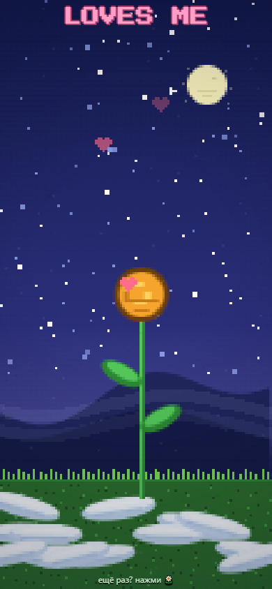

# 🌼 Loves Me, Loves Me Not

Пиксельная ночная ромашка-гадание. Срывай лепестки — «любит / не любит», в финале либо сердечки, либо холодные капли.



## Варианты

| Файл | Что это |
|---|---|
| `loves-me-daisy.html` | Та же игра для браузера — просто открой файл двойным кликом, работает и на телефоне во весь экран |
| `loves-me-not.py` | Та же игра на Python + pygame |

## Запуск Python-версии

```bash
pip install pygame
python loves-me-not.py
```

## Управление

- Клик / тап / пробел — сорвать лепесток
- В HTML-версии лепесток можно потянуть пальцем и отпустить с размаху
- `R` — заново
- Лепестков случайно 9–13: нечетное число — **LOVES ME** 💗, четное — **LOVES ME NOT**

## Техника

Оба варианта рисуют в попиксельный буфер низкого разрешения (168×236) без готовых спрайтов: `put`, `draw_petal`, `draw_heart` — всё математикой.
